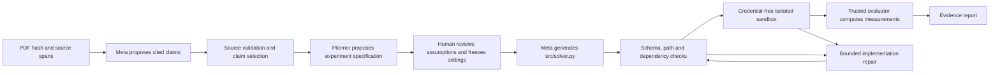

# Offline workspace and paper-to-code design

Updated 30 October 2026. This is a working single-owner development workflow, not
the completed Meta/Modal hackathon integration or full SRS compliance.

## Start and sign in

From the repository root, run the setup script once, then start three terminals:

```powershell
.\scripts\setup.ps1

# Terminal 1: API
.\.venv\Scripts\python.exe -m uvicorn services.api.main:create_app --factory --host 127.0.0.1 --port 8000

# Terminal 2: durable local worker
.\.venv\Scripts\python.exe -m services.worker.main

# Terminal 3: dashboard
npm.cmd --prefix apps/web run dev
```

Open <http://127.0.0.1:3000>. On its first start, the backend generates a local access
code in `data/access-code.txt`. Open that file locally and use the code to sign in;
do not paste it into chat or commit it. A custom `P2P_DATA_DIR` changes the data
directory. Existing `.env` keys remain untouched, and provider/runner defaults remain
offline/disabled.

Authentication uses a PBKDF2 password hash and hashed, expiring session tokens. The
browser receives an HttpOnly, SameSite=Strict cookie. This is single-owner localhost
access, not a public multi-tenant identity system. Public deployment needs TLS,
secure cookies, production authentication and a separate security review.

## Try the complete local flow

1. Choose **Use demonstration PDF**, or upload a text PDF up to 25 MiB / 50 pages.
   Upload returns a durable extraction job. The separate worker parses it in a
   process with a 30-second deadline, 512 MiB memory limit, and bounded output.
2. Choose a source passage. Compare its exact quotation, page and bounding box with
   the original PDF. Scans, encrypted/corrupt PDFs and over-limit inputs fail with
   specific messages. Reading order, equations and tables require manual review.
3. Enter a measurable claim and select the supported method. These are explicitly
   user-provided claims; offline mode does not pretend to infer claims with a model.
4. Review the specification JSON. Set `target_relative_error` and provide an explicit
   `target_rationale`. Every setting records an origin and rationale. Missing critical
   values block approval. The current adapter only supports the documented synthetic
   randomized Kaczmarz experiment, always as an adapted/engineering investigation.
5. Save and approve the exact specification hash. Editing a saved version creates
   a new immutable version and requires new approval. Unsaved changes cannot be approved.
6. Choose one of two clearly separated actions:
   - **Stage offline code preview:** exercise the provider contract and bounded
     validation/repair controller using the reviewed fixture template. It is not
     Meta-generated and is never executed. The job ends `awaiting_sandbox`.
   - **Run reviewed engineering fixture:** execute the fixed installed solver,
     independently check every update and measure its numeric outputs. This does
     not execute the staged code or reproduce the selected paper.
7. Inspect persisted events, measurements, limitations and staged source. Download
   the evidence ZIP. The export checks stored artifact hashes before packaging and
   includes a new ZIP manifest. Original PDFs, full extracted papers, credentials
   and the workspace database are excluded.
8. Delete a paper through the explicit confirmation control when needed. Access to
   its claims, specs, jobs and files is revoked immediately. The worker cancels active
   work and removes active files, exports and records; a content-free tombstone remains.

Local SQLite state and artifacts live under ignored `data/`. The standalone fixture
CLI still saves evidence under ignored `artifacts/`. Neither directory belongs in Git.

## How live code generation will work



The generation input is the selected claim, its exact source passages (including
cited settings), and the approved experiment specification. The model writes a small
implementation against a fixed `solve(payload)` interface. It does not translate
the entire paper into an arbitrary repository, pick its own evaluator, fetch random
datasets, install packages, or choose a final verdict.

The current contract provides matrix/RHS inputs and frozen row schedules. The
implementation returns the initial vector and every subsequent iterate. The trusted
evaluator calculates error/residuals from its own data and checks the update trace.
For future supported experiments, each requires its own reviewed input/output and
evaluation adapter; this is not universal paper coverage.

The controller allows at most three implementation repairs after the initial
attempt, one retry for malformed structured output, 20 calls, bounded output tokens,
30 seconds per generation call, and a 15-minute controller budget. Earlier attempts,
diagnostics, proposal JSON, usage metadata and code diffs are retained. Changes to
seeds, data, target, evaluator or accepted settings are a new experiment, not a repair.
Unknown cost remains unknown; monetary reservations await verified provider pricing.

Static checks are advisory and do not make generated Python safe. Generated code
has no local execution route. The isolated runner and actual Meta adapters must be
implemented and validated before the live path can run.

The model proposes and explains; it does not judge its own success. Scientific
outcomes depend on valid execution, method fidelity, comparability, sufficient trials
and frozen rules. Adapted targets never become an unqualified reproduction verdict.
The separate equivalence-policy module has inside/outside/overlap tests; the current
engineering reports intentionally retain `scientific_verdict=null`.

## Deliberate development deviations and remaining release work

- SQLite and a separate local worker replace PostgreSQL/Redis/RQ only for offline
  development. This is a documented development profile, not completed DATA-03.
- Uploads use raw `application/pdf` bytes, rather than multipart. Extraction is
  queued and returns HTTP 202. The public API shape can be normalized before release.
- One active job and five queued jobs are allowed. Worker leases renew every five
  seconds and expire after 30 seconds. Interrupted jobs fail without automatic
  duplicate execution. Reconciliation with real Modal job IDs remains unimplemented.
- Single-owner sessions protect the local API, PDFs, code, events and exports.
  Multi-user ownership, deployed TLS, cloud encryption and public hosting remain pending.
- Parser memory limits are applied with a Windows Job Object or POSIX resource
  limits. This does not supply filesystem/network isolation or prove hostile-PDF containment.
- The reviewed local solver has time/output limits, but is not a sandbox. Generated
  code execution, memory/process/disk/network sandbox tests and Modal policy remain pending.
- Explicit deletion works while the worker is running. Automatic 30-day retention,
  backup expiry, restoration/deletion replay and production recovery are not implemented.
- No runtime Meta call, cloud job, actual paper reproduction or hackathon submission
  has been performed. Live access will enable integration work, not automatically finish it.

## Verification commands

```powershell
.\.venv\Scripts\python.exe -m pytest
.\scripts\check.ps1
npm.cmd --prefix apps/web run test:e2e
```

The browser test expects installed Chrome and the three services above. For test
isolation, start both API and worker with `P2P_DATA_DIR` set to the absolute path of
`data/e2e` in this repository. It uses that workspace's generated access code and
deletes only its own demonstration paper. Test traces and screenshots are ignored.
The test exercises a synthetic demonstration document, not an external research paper.
